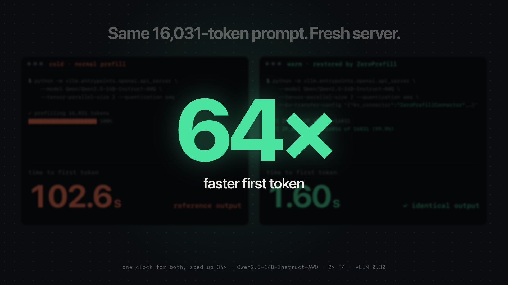

# ZeroPrefill

**Close the laptop. Keep the context.**

[](docs/media/zeroprefill.mp4)

<sub>▶ 22 seconds. Click the image to watch.</sub>

Next morning, your coding agent re-reads everything.

You work with an agent all day, close the laptop at night and come back 8 to
10 hours later. Providers keep prompt caches for minutes to an hour, so the
whole conversation is prefilled again from scratch. You pay for it in money
and wait time, and the GPU pays for it in power and water, for work that was
already done the day before.

**ZeroPrefill** is a vLLM KV connector plugin (vLLM itself is unpatched).

- Save the KV cache to disk when a session goes idle.
- Load it back into a fresh server, even on another machine.
- Skip the prefill.

Against LMCache's multi-process mode on the same machine, first-token time
after restore was 8.55 s / 3.04 s vs 14.96 s / 8.01 s, both with correct output
([comparison](#comparison-with-lmcache)).

The mechanism is not new ([related work](#related-work)). The contribution is
the measurement. Read [the caveats](#read-before-quoting) before quoting the
numbers.

All results are on Kaggle's free 2x NVIDIA T4, Qwen2.5-14B-Instruct-AWQ,
tensor parallel 2, vLLM 0.30.0, except the [Lumma-0.6B run](#lumma-06b-a-model-vllm-has-no-code-for). Raw outputs for every run are in
[`results/`](results/).

## 64x faster first token

One server prefills a 16,031-token prompt and saves its KV cache to disk, then
it is killed. The same prompt then goes to a fresh server: cold computes it the
normal way, warm restores the cache from disk. This is the real log line from
the warm server:

```
[ZP] ZP_HIT tokens=16016 of 16031 (99.9%)
```

| | cold (normal prefill) | warm (KV restored from disk) |
|---|---|---|
| time to first token | 102.6 s | **1.60 s** (64x) |
| tokens restored | 0 | 16,016 of 16,031 (99.9%) |

Raw outputs: [`results/smoke/`](results/smoke/).

## Same answer, word for word, with 17x less energy

Both servers return the same 60-token answer, byte for byte: *"This scheduler
code manages the Key-Value (KV) cache for deep learning models…"*

| | cold | warm |
|---|---|---|
| GPU energy for the request | 14,349 J | **851 J** (17x less) |
| output | reference | **identical** |

## A real agent session, resumed on another machine

**Day 1:** the [pi](https://www.npmjs.com/package/@earendil-works/pi-coding-agent)
coding agent works on [psf/requests](https://github.com/psf/requests) v2.32.3
for 7 tasks, reaching 23,699 tokens of context. Its KV cache (4.6 GiB) is saved
as the Kaggle run's output.

**Day 2:** a new Kaggle machine attaches that output, forks the same pi session
twice and sends the same next message, once with the cache restored (warm) and
once without (cold). Each arm ran twice.

| | cold | warm |
|---|---|---|
| resumed prompt | 26,788 tokens | 26,788 tokens |
| tokens restored | 0 | 23,552 (87.9%) |
| time to first token | 260.7 s / 260.7 s | **75.7 s / 73.7 s** (3.5x) |
| GPU energy, first reply | 61.8 / 62.1 kJ | **33.1 / 33.3 kJ** (46% less) |

Raw outputs: [`results/day1/`](results/day1/), [`results/day2/`](results/day2/).

## It also saves the model's own answer

Added 2026-11-17. Turn 1 sends the smoke prompt with a request for a detailed
answer. The connector saves the prompt during prefill and the 871-token answer
when the request ends. Turn 2, in a fresh server, sends prompt + answer + a new
question (16,936 tokens). Raw outputs: [`results/answer/`](results/answer/).

| | cold | warm |
|---|---|---|
| tokens restored | 0 | 16,384 (prompt-only save: at most 15,360) |
| time to first token | 111.6 s | 14.2 s |
| output | reference | **identical** |

So 1,024 tokens of the previous answer were reused. The answer's last 512
tokens were saved but not reused (partial last segment, see
[Known issues](#known-issues)). Warm is 14.2 s here against 1.60 s in the
smoke test. 552 tokens are recomputed instead of 15, but that does not
obviously account for the difference, and it is not yet explained.

Full log with dates and reasoning: [`docs/RESEARCH.md`](docs/RESEARCH.md) §6.

## Read before quoting

- **Why 3.5x and not 64x.** Only tokens the model *read* were saved, not the
  ones it *wrote*. Day 1's last answer (~3k tokens) was recomputed on Day 2,
  and that is most of the remaining 75 s. The connector now saves the answer
  too (above), but Day 2 has not been re-run with it yet.
- **Fetch cost.** Copying the 4.6 GiB cache from Kaggle's storage to local disk
  took 73.7 s, which is not included in the warm time.
- **Output match.** Each arm reproduces itself exactly. On Day 2, cold and warm
  agree for the first ~1,200 tokens of the reply, then split at a near-tie
  word. Day 1 built the KV over 8 turns while cold builds it in one pass, so
  floating-point rounding differs. Corrupt KV would diverge from the first
  token. The smoke test, where both sides compute the KV the same way, matched
  exactly.
- **Weak agent behaviour.** Qwen2.5-14B-AWQ only used tools on the first task
  and answered the rest without reading files. The session is a real 27k-token
  multi-turn conversation, but not yet a realistic codebase read.
- **The video speeds up time.** Both timers in it run on one clock, sped up
  34x. The numbers on screen are the measured ones above.

## Comparison with LMCache

Same model, GPUs, vLLM 0.30.0 and 16,031-token smoke prompt; save in one
server, restore in a fresh one. LMCache 0.5.6.

**In-process connector (`LMCacheConnectorV1`): wrong output.** With the `fs`
backend the restore loaded all 15,872 tokens on both GPUs without an error, and
the model answered as if the prompt were garbled ("contains several syntax
errors") from the first word. vLLM 0.30.0 uses the LBNHC KV cache layout on
these GPUs, which LMCache issue #6156 reports the in-process connector
mishandles; it was closed without a fix because in-process mode is deprecated.
The `local_disk` backend restored 0 tokens after the restart (LMCache issue
#1175). With LMCache's default 10 s `blocking_timeout_secs`, one GPU's read
timed out and vLLM failed the request with an empty reply. Raw outputs:
[`results/lmcache-inprocess/`](results/lmcache-inprocess/).

**Multi-process mode (`LMCacheMPConnector` + `lmcache server`, `fs` L2):
correct output.** Head to head in one Kaggle session, each tool saved once and
restored twice, each restore in fresh processes:

| | restore 1 | restore 2 | GPU energy | tokens restored | output |
|---|---|---|---|---|---|
| cold prefill (the two save runs) | 105.7 s / 100.3 s | | 14,469 / 14,307 J | 0 | reference |
| ZeroPrefill | **8.55 s** | **3.04 s** | 1,254 / 940 J | 16,016 | identical |
| LMCache MP | 14.96 s | 8.01 s | 1,775 / 1,392 J | 15,872 | identical |

Times are time to first token. Where the restore time goes, per GPU:

| | restore 1 | restore 2 |
|---|---|---|
| ZeroPrefill: read files / copy into the GPU cache | 1.0 s / 6.8 s | 0.18 s / 2.15 s |
| LMCache MP: prefetch from disk / copy into the GPU cache | 12.5 s / 0.1 s | 5.5 s / 0.1 s |

Read these with the caveats:

- Kaggle does not allow dropping the OS page cache, and about 30 GB of RAM was
  free, so both tools most likely read their files from memory rather than
  disk. These are not disk-speed numbers.
- Two restores per tool in one session. The first restore is slower for both,
  probably one-time warm-up; ZeroPrefill's 14.2 s in the answer run above was
  also a first restore, with 552 tokens to recompute.
- ZeroPrefill's cost is copying 768 small files per GPU into the paged cache
  layer by layer; LMCache's is reading its chunk files. Both look improvable.
- The separate cold server in this run failed to start because GPU memory was
  not yet free after the last LMCache step, so the save runs (full prefill, no
  cache hits) are the cold reference.

Raw outputs: [`results/lmcache-mp/`](results/lmcache-mp/) (MP mode alone,
including a run that kept the LMCache server alive across the vLLM restart:
12.0 s) and [`results/h2h/`](results/h2h/).

## Lumma-0.6B: a model vLLM has no code for

[FrontiersMind/Lumma-0.6B-Instruct](https://huggingface.co/FrontiersMind/Lumma-0.6B-Instruct)
is a custom architecture (`trust_remote_code`) with no native vLLM model. Its
embeddings are factorized (vocab x 512), so its output head first projects the
1440-wide hidden state down to 512 (`lm_head_proj`). vLLM's generic
Transformers backend has no slot for that layer and cannot load the model.
[`kaggle/lumma_vllm.py`](kaggle/lumma_vllm.py) is a small vLLM plugin that adds
it. One T4, fp16, TP 1. Raw outputs: [`results/lumma/`](results/lumma/).

| | cold (normal prefill) | warm (KV restored from disk) |
|---|---|---|
| prompt | 4,053 tokens | 4,053 tokens |
| tokens restored | 0 | 4,048 (99.9%) |
| time to first token | 2.85 s | **0.38 s** (7.5x) |
| GPU energy for the request | 422 J | **206 J** (51% less) |
| output (64 tokens) | reference | **identical** |

- The restore took 0.16 s. The cache is 419 MiB, at most 104 KiB per saved
  token (Qwen2.5-14B: 192 KB).
- A 0.6B model prefills fast, so the time win is far smaller than the 14B's 64x.
- **Under vLLM, Lumma answers 6k-, 8k- and 11k-token prompts with a single
  end-of-text token**, in fp16 and float32 alike, while a short question and
  the 4k prompt get real answers. The run therefore steps the prompt down from
  11k and uses the longest one the model answers. Whether this is the model or
  the vLLM serving path is not yet known; the next check is the same prompts
  through Lumma's own Hugging Face code.
- Lumma caches one pre-RoPE tensor per token and uses it as both key and value.
  Through vLLM's Transformers backend it is stored as separate keys and values
  like any other model, so this run does not get that halving. Native vLLM
  support for shared KV would.

## How it works

A vLLM `KVConnectorBase_V1` plugin, loaded with `kv_connector_module_path`, so
vLLM itself is not patched.

1. **Naming the memory.** vLLM stores KV in 16-token blocks. Each block gets a
   hash chained to the previous block, rooted in a fingerprint of model,
   quantization, KV dtype, block size and TP size
   ([`zeroprefill/hashing.py`](zeroprefill/hashing.py)). Appending to a
   conversation invalidates nothing; editing token N invalidates only what
   comes after it.
2. **Saving.** While vLLM prefills, the connector copies KV out of GPU memory
   in segments of 64 blocks (1,024 tokens), one safetensors file per layer per
   GPU, named by the segment's hash. Segments already on disk are skipped, so
   an agent loop does not rewrite its history every turn. Writes are atomic.
3. **Restoring.** On a new request vLLM asks the connector how much of the
   prompt it already has. The connector hashes the prompt, finds the longest
   run of complete segments on disk (all layers, all GPUs) and reports it
   (`ZP_HIT`). vLLM reserves empty blocks; the connector copies the saved
   tensors straight into them. vLLM only computes the rest.

On-disk layout:

```
<cache_root>/<layout_fingerprint>/<segment_hash>/layer_<name>.rank<r>.safetensors
```

## How we ran it

- **Kaggle, only through the CLI.** `kaggle/push.py` bundles the connector and
  a run script into one private script kernel and pushes it to the 2x T4
  machine. Outputs come back with `kaggle kernels output`.
- **pi headless.** pi talks to a small logging proxy in front of vLLM, which
  records every request's time to first token, GPU energy (NVML counters) and
  exact output.
- **Fair comparison.** Day 2 forks one saved pi session (`pi --fork`) for both
  arms, so both start from exactly the same tokens. Each arm gets a freshly
  started server and the repo reset to how pi left it on Day 1.
- **Things that would silently break it, and the fixes:** pi's auto-compaction
  (rewrites history at ~16k tokens with a 32k window) is disabled; pi's system
  prompt has no date and only depends on cwd and pi version, which are pinned;
  Day 2 uses exactly Day 1's context length, because RoPE scaling changes the
  cached K values.

## Reproduce

Needs a Kaggle account with phone verification (GPU + internet) and the Kaggle
CLI logged in (`pip install kaggle`, `python -m kaggle auth login`).

```
python kaggle/push.py smoke                                 # ~25 min
python kaggle/push.py day1                                  # ~40 min
python kaggle/push.py day2 <kaggle-user>/zeroprefill-day1   # ~60 min
python kaggle/push.py lumma                                 # Lumma-0.6B, passed (results/lumma)
python -m kaggle kernels status <kaggle-user>/zeroprefill-<run>
python -m kaggle kernels output <kaggle-user>/zeroprefill-<run> -p runs/<run>
```

Add `--file-pattern '^(results/|pi-sessions/)'` to `kernels output` to skip
downloading the multi-GB KV cache.

Unit tests need vLLM, so run them on Linux (phase 1 used WSL2):

```
python -m pytest tests/ -q     # 19 tests
```

## Repository layout

```
zeroprefill/          the connector
  hashing.py          chained per-block cache keys, layout fingerprint
  connector.py        save / lookup / restore for vLLM 0.30
  prompt.py           deterministic synthetic prompt (phase 1)
kaggle/               the 2x T4 experiments
  lib.py              install vLLM + pi, start/stop server, logging proxy, energy
  smoke.py            run 0: save, restore, compare with cold
  answer.py           turn 2 reuses the saved answer; unit tests on vLLM 0.30
  lmcache-smoke.py    LMCache in-process connector baseline
  lmcache-mp.py       LMCache multi-process mode baseline
  h2h.py              ZeroPrefill vs LMCache MP in one session
  lumma.py            smoke test on Lumma-0.6B via vLLM's Transformers backend
  lumma_vllm.py       vLLM plugin: Lumma's factorized output head
  lmc.py              LMCache MP server helpers
  day1.py             build a real pi session, save its KV cache
  day2.py             resume on a fresh machine, warm vs cold
  push.py             bundle + push as a private Kaggle kernel
results/              raw outputs of every run (no KV caches)
  smoke/  day1/  day2/  answer/  lmcache-inprocess/  lmcache-mp/  h2h/
tests/                hashing, segments, store path, end-of-session save
scripts/              phase 1: local GTX 1650 runs under WSL2
docs/
  media/              the 22-second video and its poster
  WRITEUP.md          the write-up: results, LMCache comparison, bugs found
  RESEARCH.md         plan, metrics, use cases, limits, dated status log
  phase1-handoff.md   phase 1 record: local runs, the five connector bugs
```

## Known issues

- The last answer of a session is saved when the request ends: the
  connector holds the request's GPU blocks until the worker has written them,
  one engine step later. Verified on Kaggle (above); the Day 1 / Day 2
  numbers were measured before this change.
- Saving the answer only helps if the client sends it back with the same
  token ids. A chat template that re-tokenizes the answer differently misses
  from the first differing block.
- A longer follow-up prompt cannot reuse the partial last segment (under
  1,024 tokens) of the previous save, because segments are keyed on their
  last block.
- The fingerprint now includes the RoPE settings and max context length, so
  caches written by earlier versions are not reused.
- Restore copies all layers before compute starts; no per-layer pipelining.
- Only tested on vLLM 0.30.0. The connector API changes between versions.
- Per-file invalidation (drop only the edited file's part of the cache) is not
  built. Plain resume does not need it.

## Next steps

1. Re-run Day 2 with the end-of-session save.
2. Speed up the copy into the GPU cache (6.8 s / 2.15 s per restore), e.g.
   fewer, larger files and one batched copy per layer.
3. Let a longer prompt reuse the previous save's partial last segment.
4. Day 1 v2 with Qwen3-14B-AWQ (better tool calling, native 40k) and prompts
   that require tool use.
5. More sessions and a second model size; LMCache on real disk; a break-even
   table of store vs recompute by model, context and storage speed.
6. Warm-up on open: start loading the cache when the session opens, to hide
   the fetch time.

## Related work

This mechanism is not new. Closest prior work: CachedAttention / AttentionStore
(USENIX ATC 2024), Pensieve, LMCache (2025), Mooncake, Continuum (2025, KV
time-to-live for agents), and on the energy side GreenCache and "Store or
Recompute?". Providers ship versions of it too: DeepSeek's disk cache,
Anthropic's 1-hour cache, OpenAI's extended retention. Saving the model's own
answer is not new either: LMCache's multi-process connector has a
`lmcache.mp.save_decode_cache` option (off by default). Our contribution so far
is measurement: real agent sessions resumed across machines, with energy, and
the practical failure modes found along the way.

## License

Apache-2.0. See [LICENSE](LICENSE).
